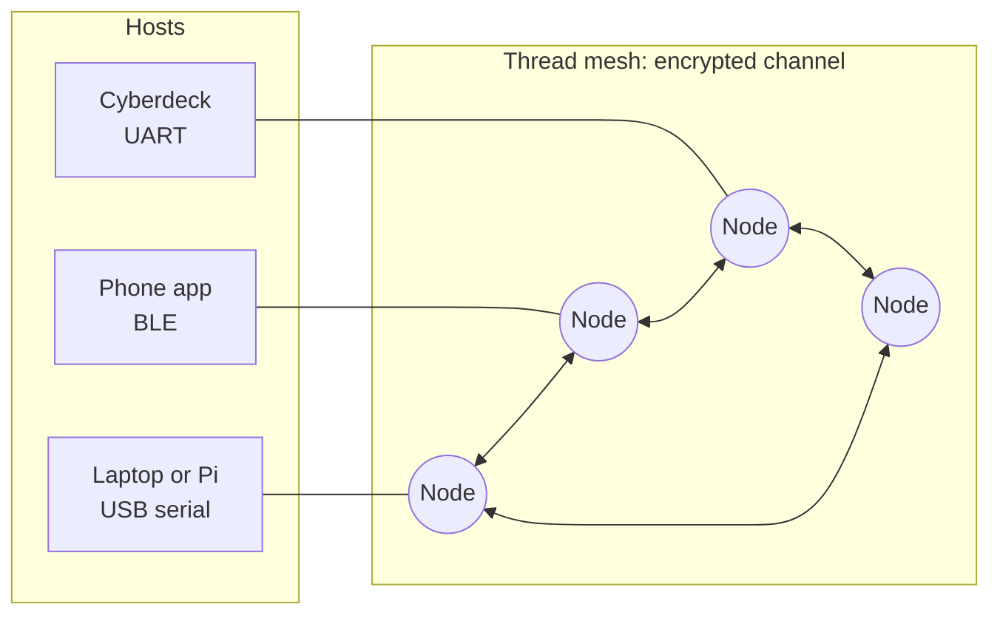

**Hanasu** is the MagNET reference design for talking over a mesh when there is no infrastructure to talk over. Small radio boards — an ESP32-C6 or a Silicon Labs MG24 — form a self-healing **Thread** network (IEEE 802.15.4, 6LoWPAN, IPv6) and carry encrypted chat, direct messages, machine-to-machine commands and file transfers between them. Anything that can open a serial port or a BLE connection becomes a mesh terminal: a laptop, a phone, a Raspberry Pi, a cyberdeck.

The inspiration is the OLPC laptop's built-in mesh, which let children's laptops talk to each other where there was no network at all. Hanasu brings that idea to open hardware for education and STEM, as part of the [PONY Cyberdeck](https://github.com/IoTone/PONY-Cyberdeck-25/issues/7) project, and it doubles as a substrate for lighting control and swarm-style edge intelligence.

## What a node does

- **Chat and DMs** — multicast chat to everyone on a channel, CON-unicast direct messages to one node, with display names and a catch-up buffer for nodes that were asleep. See [Wire Protocol](/docs/hanasu/protocol/).
- **Private, encrypted channels** — every frame is encrypted and authenticated with a key derived from the channel credential (a passphrase, a QR payload or a seed phrase), and an admin can rotate the channel to a new key epoch. See [Security Model](/docs/hanasu/security/).
- **Signed administration** — each node has its own identity key; privileged mesh commands must be signed by a key on the target's admin allow-list.
- **One line protocol for every host** — the [Host Control Protocol](/docs/hanasu/hcp/) is the same over USB serial, UART and BLE GATT, readable by a person and parseable by a program or an LLM agent.
- **An embedded Forth** — type `FORTH` and the same link becomes a REPL on the node, with words for the mesh, hooks that run on incoming traffic, autorun scripts and signed role bundles. See [Forth, Bundles & Bots](/docs/hanasu/forth-and-bots/).
- **Files and photos** — the [extended transfer](/docs/hanasu/extended-transfer/) moves payloads far larger than one frame, with windowing and loss recovery.
- **A clock without the internet** — [mesh time](/docs/hanasu/mesh-time/) spreads one node's clock across the mesh.
- **Over-the-air firmware updates** — signed packages staged over the mesh, applied by an admin, tried, then confirmed or rolled back automatically. See [Over-the-Air Updates](/docs/hanasu/ota/).

## What's real today



| Milestone | What it delivered | Validated |
|---|---|---|
| E-A to E-C | ESP-IDF rewrite: the MagNET core, the v2.1 envelope, chat and DMs, leader failover, the HCP dispatcher and Forth mode | 2026-07-30 |
| E-D | Encryption, channel credentials, epochs, identity keys, signed admin commands | 2026-07-31 |
| E-E | Forth automation: hooks on incoming chat and commands, autorun scripts | 2026-07-31 |
| E-F | HCP over BLE GATT with bonding; the companion app's live mesh view | 2026-08-02 |
| E-G | Scale hardening: jittered announces, catch-up for sleepy nodes | 2026-08-03 |
| E-H | Type 6 extended transfer for photo-sized payloads | 2026-08-11 |
| Zephyr port | The same core on the XIAO MG24, meshing with the C6 nodes | 2026-09-29 |
| OTA | Signed packages, admin-signed remote apply, reports, revocation, release keys | 2026-09-30 |

The companion **MagNET app** (`magnet_app/` in the main repo) is a "Hanasu mesh configurator and field console": it provisions nodes and shows the live mesh over BLE.

## Hardware

Hanasu runs on two chip families, from one shared code base:

| Board | Chip | Notes |
|---|---|---|
| Seeed XIAO ESP32C6 | ESP32-C6 (RISC-V, Thread + BLE + Wi-Fi) | The bench workhorse; small, and fits expansion boards |
| M5Stack NanoC6 | ESP32-C6 | Built-in RGB LED |
| Seeed XIAO MG24 | EFR32MG24 (Cortex-M33, Thread + BLE) | Runs the same core on Zephyr, with MCUboot |

Details, build variants and memory notes are on [Boards & Builds](/docs/hanasu/boards/); the Zephyr port has its own page, [XIAO MG24 on Zephyr](/docs/hanasu/mg24-zephyr/).

## Reading guide

| If you want to… | Read |
|---|---|
| Learn the vocabulary | [Concepts & Vocabulary](/docs/hanasu/concepts/) |
| See how the pieces fit | [Architecture](/docs/hanasu/architecture/) |
| Get two nodes talking | [Getting Started](/docs/hanasu/getting-started/) |
| Drive a node from a program | [Host Control Protocol](/docs/hanasu/hcp/) |
| Understand what is encrypted and signed | [Security Model](/docs/hanasu/security/) |
| Decode frames on the air | [Wire Protocol](/docs/hanasu/protocol/) |
| Move files | [Extended Transfer](/docs/hanasu/extended-transfer/) |
| Script a node | [Forth, Bundles & Bots](/docs/hanasu/forth-and-bots/) |
| Update a fleet | [Over-the-Air Updates](/docs/hanasu/ota/), then the [OTA Operator Guide](/docs/hanasu/ota-operations/) |

## Relation to Hive AI

Hanasu and [Hive AI](/docs/hive-ai/) share their control layer: both run **ESPIDFORTH**, and both install the same signed Forth **role bundles**. Hive AI organizes Wi-Fi nodes under a ruler on a LAN; Hanasu is the infrastructure-free path, a Thread mesh with no access point and no coordinator that must stay up.

The full design, decisions and test records live in the Hanasu repo, `reference-designs/MagNET_Thread_COaP_hanasu_esp32c6/`: `MAGNet_Protocol_DESIGN_PROPOSAL.md` and the specs under `docs/`.
