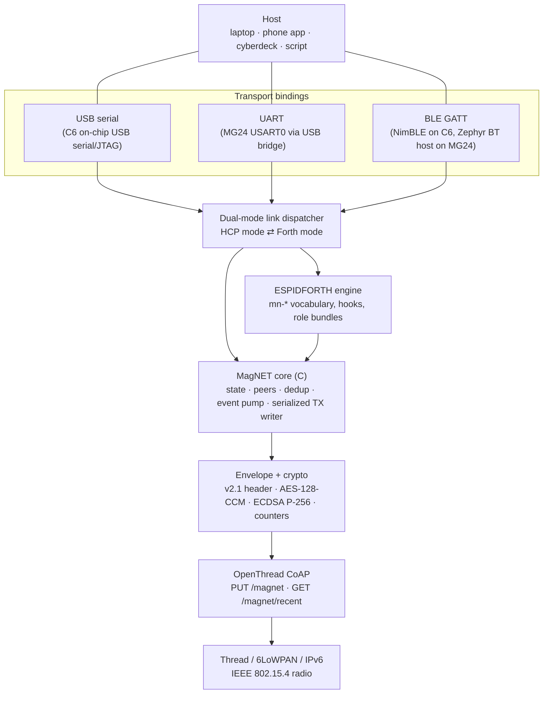
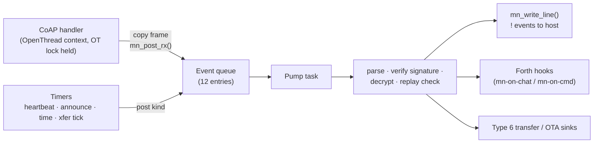
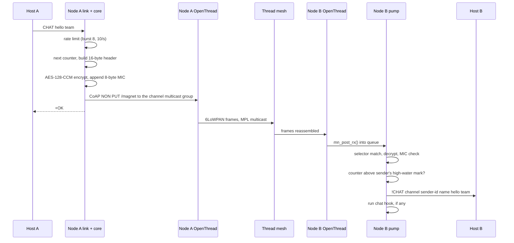

A Hanasu node is a radio modem with opinions. The host (a laptop, phone, or cyberdeck) holds the user interface and any large files; the node owns the mesh, the keys, and the protocol. Between the two runs a single text link. Underneath it, a C core turns host commands into encrypted envelopes, hands them to OpenThread as CoAP messages, and turns whatever arrives from the mesh back into events for the host.

## The layers

| Layer | Responsibility | Main source (Hanasu repo) |
|---|---|---|
| Transport bindings | Move bytes between host and node; BLE also enforces bonding for privileged verbs | `firmware-idf/src/main.c`, `magnet_ble.c`; `firmware-zephyr/src/main.c`, `magnet_ble_zephyr.c` |
| Link dispatcher | Read one line at a time, route it to HCP or Forth, emit exactly one reply per HCP command | `components/magnet/magnet_link.c` |
| Forth vocabulary | Expose the core to the ESPIDFORTH interpreter as `mn-*` words | `components/magnet/magnet_forth.c` |
| MagNET core | Lifecycle state, peer table, replay table, event pump, serialized output, channel and admin management | `components/magnet/magnet_core.c` |
| Envelope + crypto | Pack and parse the 16-byte header; derive keys; encrypt, sign, verify | `magnet_envelope.c`, `magnet_crypto.c` (IDF) or `magnet_crypto_psa.c` (Zephyr) |
| OpenThread CoAP | Join the Thread network, subscribe to the channel's multicast group, send and receive CoAP | `components/magnet/magnet_ot.c` |
| Extended transfer, OTA | Type 6 file transfer, package verification, slot writing | `magnet_xfer.c`, `magnet_pkg.c`, `magnet_ota_idf.c` / `firmware-zephyr/src/ota.c` |

### One implementation, two front ends

Every operation the node can do (send chat, set the channel, list peers, rotate the epoch) is a single C function in the core. The HCP verb `CHAT` and the Forth word `mn-chat` both call `mn_chat()`. Keeping the logic in one place means the text protocol and the scripting language cannot drift apart, and it keeps the security-critical paths (key derivation, nonce discipline, signatures) in reviewable C. Forth has no words that touch key material.

### HCP and Forth on one link

The link dispatcher is a task that owns the input stream. It never hands the stream to the interpreter's own blocking REPL; it reads a line, and then:

- **In HCP mode** (the default) it parses the line as a command, calls the core, and writes exactly one `+` or `-` reply. Inbound mesh traffic shows up separately as `!` events.
- **In Forth mode** (entered with `FORTH`) it passes the line to the interpreter and prints `ok>`. A line containing only `.hcp` returns to HCP mode.

Any transport can feed a complete line to the same dispatcher (`mn_link_feed_line()`), which is why USB, UART, and BLE all speak an identical grammar. See [HCP](/docs/hanasu/hcp/) and [Forth & Bots](/docs/hanasu/forth-and-bots/).

### The Thread network underneath

All nodes join the same Thread network, built from a fixed development dataset (channel 24, PAN ID `0x4d4e`, network name `MagNET-dev`, and a well-known network key). Every node is router-eligible, and Thread's own leader election and route repair handle failover. Hanasu channels are an **application-layer** construct on top of that one network: each channel has its own derived keys and its own multicast group, so private conversations do not need separate Thread networks. A consequence worth knowing is that Thread's link-layer encryption is not what keeps a channel private; the channel's own AEAD is. See [Security Model](/docs/hanasu/security/).

## Concurrency: one writer, one pump

Three kinds of code want to talk to the host at once: the dispatcher answering a command, the mesh delivering a chat, and Forth printing output. Two rules keep that safe.

### The serialized TX writer

Every line the node emits (`+`/`-` replies, `!` events, `#` comments) goes through one function, `mn_write_line()`. It takes a mutex, writes the whole line plus CRLF, and releases it, so an incoming `!CHAT` can never land in the middle of a `+OK`. The same call mirrors the line to a connected BLE client. The mutex is recursive because the dispatcher holds it across an entire Forth evaluation (so Forth output is also atomic with respect to events) and `mn-*` words called from Forth print through the same writer.

The writer also refuses to let one slow host stall the node. When the USB serial buffer is full and no one is reading, serial output is dropped after a short grace period rather than blocking. This was a real field bug: an unread serial port once delayed every BLE response behind it.

### The event pump

OpenThread runs its callbacks with the OpenThread lock held. A host-side task, meanwhile, holds the TX mutex while it sends (and sending takes the OpenThread lock). If the CoAP receive callback tried to take the TX mutex to print an event, the two locks could be taken in opposite orders and deadlock.

So mesh-side code never prints. The CoAP handler acknowledges a confirmable request, copies the raw frame into a queue, and returns. A dedicated **pump task** drains the queue and does all the real work in an ordinary task context:

The pump also runs timer work (heartbeat, jittered announce, mesh-time replies, transfer pacing, OTA reports), so timer callbacks are equally free of locking hazards. If the queue is full, the frame is dropped and counted (`STATS` reports it as `qdrop`), on the reasoning that the mesh is lossy anyway.

Two further rules follow from the same design:

- **Forth never runs in a radio callback.** Hooks are invoked by the pump task, with the message passed as a Forth string.
- **Forth is not re-entrant.** The dispatcher and a mesh-triggered hook could otherwise evaluate at the same time, so all evaluation goes through `mn_forth_exec()`, which takes the TX mutex and then the engine mutex in a fixed order.

## A chat message, end to end

A direct message follows the same path with two differences: it is a confirmable (CON) CoAP PUT to the peer's ML-EID instead of the multicast group, and the receiver reports it as `!DM`. Accepted multicast chat (sent or received) is also kept, still encrypted, in a 12-frame ring that peers can fetch with `GET /magnet/recent`, so a node that missed traffic can catch up. See [Wire Protocol](/docs/hanasu/protocol/).

## State the core keeps

| Structure | Size in current firmware | Purpose |
|---|---|---|
| Peer table | 40 entries | Device ID, display name, last address |
| Replay (high-water) table | 40 entries, least-recently-used eviction | Highest counter seen per sender |
| Catch-up ring | 12 frames | Recent multicast chat for `/magnet/recent` |
| Outgoing queue | 4 messages | Chats held while `DEGRADED` |
| Admin allow-list | 4 keys | Public keys allowed to sign ADMIN commands |
| Saved script | 1 KB | Forth source run at boot |

Persistent values (identity key, channel root secret, name, admins, counter block, script) live in non-volatile storage under one namespace, which is what lets factory reset erase them all in one step.

## Bring-up order

The order the firmware starts things in matters on a chip with no PSRAM. The C6 build follows it in `firmware-idf/src/main.c`:

1. Bring up the USB transport so the node can report problems even if later steps fail.
2. Initialize Forth and claim its dictionary heap while RAM is still unfragmented.
3. Initialize non-volatile storage, then the MagNET core (counter, channel, identity key, admins, event pump), then register the Forth vocabulary.
4. Re-apply saved signed role bundles, then run the saved boot script, so hooks are armed before traffic arrives.
5. Start the link dispatcher and emit `!READY`.
6. Start OTA health tracking (OTA builds).
7. Start BLE, either as a provisioning window (only while still on the default channel) or permanently on a companion build.
8. Start OpenThread last.

Setting a channel with `CHANNEL SET` tears BLE down on provisioning builds, handing the shared 2.4 GHz radio and NimBLE's RAM back to Thread. A companion build (`esp32c6_ble_resident`) skips that teardown so a phone can stay attached.

## One core, two targets

The same MagNET core is compiled for two very different chips:

| | ESP32-C6 | Seeed XIAO MG24 |
|---|---|---|
| Directory | `firmware-idf/` | `firmware-zephyr/` |
| OS / SDK | ESP-IDF (FreeRTOS) via PlatformIO | Zephyr, built with `west --sysbuild` |
| Core sources | `components/magnet/*.c` | The same files, compiled unmodified out of `../firmware-idf/` |
| Crypto backend | mbedTLS (`magnet_crypto.c`) | PSA Crypto port (`src/magnet_crypto_psa.c`) |
| BLE | NimBLE | Zephyr Bluetooth host, same service and UUIDs |
| Boot / OTA | ESP-IDF app slots with rollback | MCUboot |

The trick that makes this work is `firmware-zephyr/compat/`: a small set of headers and sources that implement the subset of FreeRTOS (tasks, queues, mutexes, timers) and ESP-IDF APIs (`esp_timer`, `esp_random`, NVS, logging) the core actually calls, on top of Zephyr kernel objects and the Zephyr settings store. Because the core is not forked, a protocol change lands on both targets at once and the two cannot drift. Mixed C6 and MG24 meshes chat, transfer files, and update each other's firmware. See [MG24 & Zephyr](/docs/hanasu/mg24-zephyr/) for the port and [Boards](/docs/hanasu/boards/) for supported hardware.
