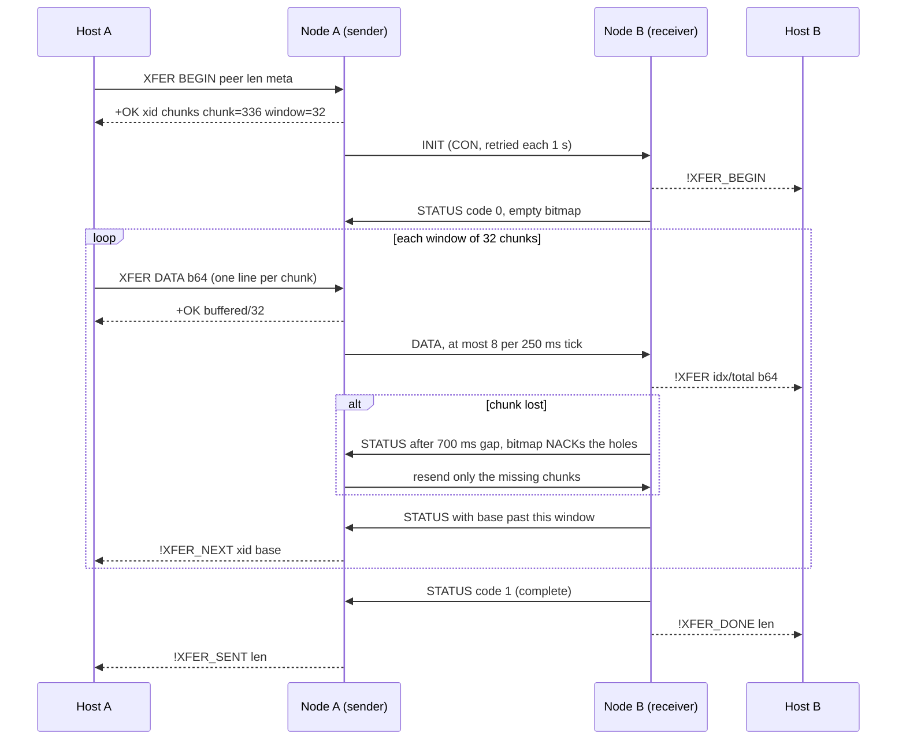

**Type 6** is Hanasu's extended transfer: the path for payloads too big for a chat frame, such as photos. The v2.1 envelope's 4-bit fragment field caps an ordinary app-layer message at about 17 KB. Type 6 carries a 16-bit chunk index in the payload instead, so a single session can move up to about 1.31 MB. Implementation lives in `firmware-idf/components/magnet/magnet_xfer.c`; the spec is `docs/EXTENDED-TRANSFER.md`.



## Design choices

- **Unicast CON only.** The E-B saturation measurements showed fragmented multicast losing about 7% even on a quiet channel and collapsing under load. CON unicast gets CoAP's own retransmission, so Type 6 never touches the multicast group.
- **The node stays a modem.** The host holds the file. The receiving node forwards each chunk up its host link as an event and keeps only a bitmap. The sending node buffers one window so it can retransmit without asking the host again.
- **Normal channel encryption.** Every chunk is one ordinary AEAD envelope frame and uses one nonce counter, so the nonce rules from the [security model](/docs/hanasu/security/) hold unchanged. Retransmitted chunks get fresh counters. The receiver deduplicates by chunk index, not by counter.
- **One transfer per direction per node.** This applies per node, not per peer pair. Sessions are keyed by `xfer_id`, so multiplexing could come later without a wire change.
- **Re-encode on the host.** Send a 30–100 KB re-encode, not the camera original.

## Numbers

| Parameter | Value | Why |
|---|---|---|
| Chunk payload | 336 B (`MN_XFER_CHUNK`) | base64(336) = 448 chars, so both the `XFER DATA` line and the `!XFER` event stay under the 512-byte HCP line cap |
| Window | 32 chunks, 10.5 KiB (`MN_XFER_WINDOW`) | Sender-side RAM. The STATUS bitmap field is 64 bits, so the wire format already allows a wider window |
| Max chunks | 4096, about 1.31 MB (`MN_XFER_MAX_CHUNKS`) | The receiver bitmap is a 512 B static buffer |
| Pacing | 8 chunks per 250 ms tick | About 10.7 KB/s offered, under the measured OT acceptance ceiling per node |
| Frame on the wire | 16 header + 5 + 336 + 8 MIC = 365 B | About four 802.15.4 fragments, each MAC-acked, plus a CoAP retry per chunk |
| `meta` | 0–64 bytes | A larger `meta_len` drops the INIT frame |

| Timer | Value | Action |
|---|---|---|
| INIT retry | 1 s, 6 tries | No STATUS after 6 tries: `!XFER_FAIL timeout` |
| Sender STATUS wait | 2.5 s | Resend every unacked chunk, up to 6 rounds |
| Receiver gap | 700 ms | Send a STATUS whose bitmap NACKs the holes |
| Idle abort | 30 s, either side | Abort, tell the peer, free the session |

## Wire format

The first payload byte is the subtype. Integers are big-endian except the bitmap, which is a little-endian u64 where bit *i* means chunk `base + i` was received.

| Subtype | Direction | Layout |
|---|---|---|
| `0x01` INIT | sender to receiver, CON | `xfer_id` u16, `total_len` u32, `total_chunks` u16, `chunk_len` u16, `meta_len` u8, `meta` |
| `0x02` DATA | sender to receiver | `xfer_id` u16, `chunk_idx` u16, chunk bytes (every chunk is `chunk_len` except the last) |
| `0x03` STATUS | receiver to sender, CON | `xfer_id` u16, `window_base` u16, `bitmap` u64, `code` u8, optional `reason` u8 |
| `0x04` ABORT | either | `xfer_id` u16, `reason` u8 |

STATUS `code` values:

| Code | Meaning |
|---|---|
| 0 | In progress. The bitmap is the ACK/NACK picture |
| 1 | Complete |
| 2 | Abort, unsupported, or refused |
| 3 | Busy. A transfer is already inbound |

The receiver's STATUS always describes **the window that contains its first missing chunk**. A STATUS whose base is past the sender's current window therefore means "this window is fully received, advance", so no separate ACK subtype is needed.

### The refusal reason byte

Byte 14 of STATUS is optional and appears only with code 2. It carries a **receive sink's** reason for refusing the content (see [Receive sinks](#receive-sinks)). Without it, STATUS is a 14-byte frame. Receivers of STATUS must accept a length of 14 or more and ignore bytes they do not understand, which keeps older firmware compatible. On the sender, a nonzero reason surfaces as `!XFER_FAIL <xid> refused:<n>`.

## Session lifecycle



1. **BEGIN.** The host calls `XFER BEGIN`. The node answers with the `xfer_id` and geometry and sends INIT, retrying every second until a STATUS arrives or six tries pass.
2. **Accept.** The receiver auto-accepts. Channel membership is the trust boundary, as it is for chat. It opens a session, emits `!XFER_BEGIN`, and answers STATUS code 0. If a transfer is already inbound it answers code 3, and the sender fails fast with `!XFER_FAIL busy`.
3. **DATA and windows.** The host feeds exactly one window of chunks with `XFER DATA`. The node paces them out at up to 8 per tick. The receiver forwards each new chunk to its host immediately, in whatever order it arrives. **The host reassembles by index.**
4. **NACK.** A lost chunk leaves a hole in the bitmap. The receiver's 700 ms gap timer sends a STATUS that NACKs exactly the holes, and the sender's next tick resends only those. A lost STATUS is covered by the sender's 2.5 s timeout, and the duplicate chunks are dropped by the bitmap.
5. **NEXT.** When a window is fully acknowledged, the sender emits `!XFER_NEXT` and the host feeds the next one.
6. **COMPLETE.** After the last chunk the receiver sends STATUS code 1 and emits `!XFER_DONE`. The sender emits `!XFER_SENT`.
7. **Refused or failed.** Every session ends in exactly one terminal event. A failure is `!XFER_FAIL` with one of the reasons below.

### Failure handling

- **Lost ABORT.** `X_ABORT` is sent three times at 50 ms intervals, because an abort right after a chunk burst can bounce off OpenThread backpressure. If all three are lost, a new INIT from the same peer with a different `xfer_id` supersedes the stale inbound session instead of getting a busy answer.
- **Host stops feeding.** A sender whose host dies at a window boundary has nothing unacked, so the resend logic never runs. The 30 s idle timer aborts that session. Without it, every later `XFER BEGIN` would return `E_BUSY`.
- **Peer disappears.** The receiver's own 30 s idle abort sends a best-effort `X_ABORT`, so the sender fails at once instead of running through its whole resend schedule.
- **`xfer_id` collision.** A repeated INIT counts as a duplicate only if `total_len`, `total_chunks` and `chunk_len` all match. Otherwise it supersedes the old session.

### Receive-side validation

Type 6 parses bytes chosen by a peer, so the receiver checks them before acting:

- `meta_len` is bounded against the receiver's buffer.
- `meta` is reduced to printable ASCII without spaces before it reaches an event line, so a filename cannot shift fields or inject a line that looks like host protocol.
- Chunk index and length are checked against the announced geometry, and the geometry is checked for consistency before a session opens.
- `X_STATUS` and `X_ABORT` must match the session's peer device id as well as the `xfer_id`. The 16-bit id is visible to every channel member, so without this check one member could forge a COMPLETE into another member's transfer or force an abort.

None of these checks appear on the wire, so nodes with and without them interoperate.

## Host surface

The verbs are part of [HCP](/docs/hanasu/hcp/). `CAPS` advertises `xfer_chunk=336 xfer_window=32 xfer_max_chunks=4096`.

| Command | Success | Errors |
|---|---|---|
| `XFER BEGIN <peer-ipv6> <total_len> [<meta>]` | `+OK xid=<hex> chunks=<n> chunk=336 window=32` | `E_BAD_STATE` (node not READY), `E_BUSY` (an outbound transfer is active), `E_SYNTAX` (bad arguments or more than 4096 chunks), `E_NO_PEER` (address does not parse) |
| `XFER DATA <b64>` | `+OK <buffered>/32` | `E_BAD_STATE` (no transfer), `E_BUSY` (window full, wait for `!XFER_NEXT`), `E_SYNTAX` (bad base64, or a chunk that is not exactly 336 raw bytes except the last) |
| `XFER ABORT` | `+OK aborted` | `E_BAD_STATE` if nothing is active. Aborts the outbound transfer, or the inbound one if there is no outbound, and tells the peer |
| `XFER STATUS` | `# xfer …` lines, then `+OK` | |

### Events

Events belong to the `xfer` class, so `SUB xfer` / `UNSUB xfer` control them like any other class.

| Event | Side | Meaning |
|---|---|---|
| `!XFER_BEGIN <from_id> <xid> <total_len> <chunks> <chunk_len> <meta>` | receiver | A session opened |
| `!XFER <from_id> <xid> <idx>/<total> <b64chunk>` | receiver | One new chunk |
| `!XFER_DONE <from_id> <xid> len=<n>` | receiver | Complete |
| `!XFER_NEXT <xid> <base>` | sender | Feed the next window |
| `!XFER_SENT <xid> len=<n>` | sender | Fully acknowledged (and accepted, if the receiver used a sink) |
| `!XFER_FAIL <xid> <reason>` | either | Terminal failure |

| `!XFER_FAIL` reason | Side | Meaning |
|---|---|---|
| `timeout` | both | Sender: 6 INIT tries, 6 resend rounds, or 30 s idle. Receiver: 30 s without a chunk |
| `busy` | sender | The peer already has an inbound transfer (code 3) |
| `refused` | sender | The peer rejected the INIT geometry (code 2, no reason) |
| `refused:<n>` | both | A receive sink rejected the content with reason *n* |
| `peer-abort` | both | The peer sent `X_ABORT` |
| `aborted` | both | This node's host issued `XFER ABORT` |
| `superseded` | receiver | The same peer opened a new transfer over this one |

`tools/xfer.py` is the reference host implementation: send a file, receive to a file, or run a single-node loopback self-test against the node's own ML-EID. `tools/chat-bench/` adds photo sending to the browser test rig.

## Receive sinks

By default a received transfer streams up the host link as `!XFER` events. A node with no host, such as a mesh OTA target, registers a **receive sink** instead:

```c
typedef struct {
    bool (*claim)(const uint8_t sender_id[4], const char *meta,
                  uint32_t total_len, uint16_t chunk_len);
    int  (*on_chunk)(uint16_t idx, uint32_t offset,
                     const uint8_t *data, size_t len);
    int  (*on_done)(bool complete);
} mn_xfer_sink_t;

void mn_xfer_set_sink(const mn_xfer_sink_t *sink);
```

- `claim()` sees each inbound BEGIN and returns true to take the transfer.
- Every verified, de-duplicated chunk of a claimed transfer then goes to `on_chunk()`, **not** to the host.
- `on_done(true)` closes a complete transfer. `on_done(false)` means the transfer died (timeout, abort, superseded), and its return value is ignored.
- `on_chunk()` and `on_done(true)` return 0 to continue, or a reason from 1 to 255 to **refuse**. The receiver then answers STATUS code 2 with that reason byte, and both sides emit `!XFER_FAIL <xid> refused:<n>`. A refusal can come at the first bad chunk or in place of COMPLETE after the last one.
- `!XFER_BEGIN`, `!XFER_DONE` and `!XFER_FAIL` are still emitted. All callbacks run on the pump task. With no sink registered, behavior is unchanged.

Because COMPLETE is sent only after `on_done(true)` returns 0, a sender's `!XFER_SENT` means the content was **accepted**, not just delivered.

### How OTA plugs in

The OTA component registers its sink at startup (`mn_ota_sink_init()` in `magnet_ota_idf.c` on the C6, `firmware-zephyr/src/ota.c` on the [MG24](/docs/hanasu/mg24-zephyr/)):

| Step | ESP32-C6 sink behavior |
|---|---|
| `claim` | Takes only transfers whose `meta` is exactly `mnpkg:1`; anything else falls through to the host path. Also refuses to claim if `chunk_len` cannot hold the 256-byte package header or if there is no update partition |
| `on_chunk` | Chunk 0 carries the package header, which is checked at once. Later chunks are written into the inactive OTA slot |
| `on_done(true)` | Checks the payload hash, the image, and the minimum running version. Only then does the node answer COMPLETE and emit `!OTA staged …` |

The refusal reason is the OTA package check number (for example 7 = `E_PKG_SHA`), so a sender sees `!XFER_FAIL <xid> refused:7` for a bad payload hash. Staging is the transfer half of OTA; applying it is a separate admin-signed command. See [OTA](/docs/hanasu/ota/) and [OTA Operations](/docs/hanasu/ota-operations/).

## Measured throughput

All numbers below come from the validation runs recorded in `docs/EXTENDED-TRANSFER.md` and `docs/NEKOBOT.md`.

| Run | Result |
|---|---|
| 50 KB, two nodes over the air (Waveshare C6 to Waveshare LCD-1.47, RSSI −52) | A to B 5.44 KiB/s, B to A 5.38 KiB/s, sha256-identical |
| Repeat runs of the same 50 KB transfer | 4.7–5.4 KiB/s |
| 50 KB while the receiver runs a `STRESS 25 200` multicast flood | 1.41 KiB/s (1.1–1.4 across runs), byte-identical, `rx err=0` |
| Real JPEGs, 16 KB / 67 KB / 300 KB, both directions | About 5.3 KiB/s, 10/10 intact, chat flowing both ways mid-transfer |
| Single-node loopback to own ML-EID, 1 B to 200 KB | About 6.0 KiB/s, `tx err=0 rx err=0 dup=0` over 836 frames, heap unchanged |
| About 48 KB photo during a 4 h 50 m catbot run | 3/3 delivered, about 10.5 s each |

Throughput follows RF conditions and channel load rather than the protocol. Correctness did not vary: every run reassembled byte-identical.

## Limits

- One transfer per direction per node.
- No multicast "advertise, then pull" group-photo flow yet. It would be a Type 1 notice plus a per-peer `XFER BEGIN`, all on the host.
- No resume across reboots. A transfer takes seconds to minutes, and the host retries.
- No Forth words for transfer. The use case is host-driven.
