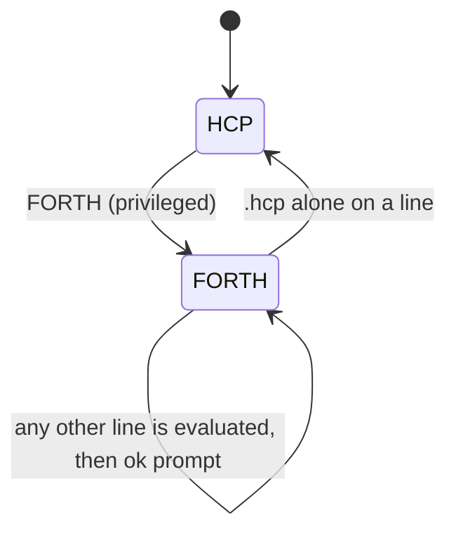

HCP is how a laptop, phone, headset or script talks to a Hanasu node. It is one text grammar, designed to be equally usable by an LLM driver, a chat-app adapter and a person at a serial monitor. The node is the radio modem, and the host decides what to say. The same lines travel over every transport the node offers. Today that means USB serial (the C6's on-chip USB-serial-JTAG, or the MG24's USART0 through its SAMD11 bridge) and BLE-GATT.

This page describes protocol version **2.1** as implemented in firmware `0.7.0-eh`. The source of truth is the dispatcher, `firmware-idf/components/magnet/magnet_link.c`, which both the ESP32-C6 and the MG24 build compile. Where design proposal §11.3 says something different, this page follows the code and notes the difference.

## Framing

- **One logical message per line**, UTF-8, ended by `\n` (a `\r` also ends a line). The node skips blank lines.
- **Maximum line length is 512 bytes including the terminator**, so 511 characters of content. A longer input line is drained to its end and answered with `-ERR E_LINE_TOO_LONG` (no tag). `CAPS` advertises the limit as `maxline=512`.
- A command is `[@tag] VERB [args…]`. Verbs are case-sensitive uppercase. For free-text verbs (`CHAT`, `DM`, `SCRIPT SET`, …) the text is **the rest of the line**, verbatim, with no quoting.
- **Optional correlation tag.** If a line starts with `@<tag>`, the node echoes it on that command's reply: `@a1 +OK`. The design specifies 1–8 alphanumeric characters. The firmware copies up to 15 characters and does not reject longer or other characters, so stay within the spec. Events never carry a tag.
- **HCP mode does not echo** input. The reply is the only feedback.

### Every line's first character says what it is

| First character | Class | Direction | Meaning |
|---|---|---|---|
| (a verb) | command | host → node | `VERB args…`, optionally `@tag`-prefixed |
| `+` | success | node → host | The single success reply (`+OK …`, `+PONG`, `+QUEUED n`) |
| `-` | failure | node → host | The single failure reply: `-ERR <CODE> <human text>` |
| `!` | event | node → host | Unsolicited: a chat arrived, the state changed, a peer joined, … |
| `#` | comment | node → host | Human-readable detail. Parsers must ignore it |

A tagged reply starts with `@tag ` and then the `+` or `-`.

**Every command gets exactly one `+` or `-` reply**, never zero and never two. Verbs that print a listing (`PEERS`, `MESH`, `SYSINFO`, `HELP`, `ADMIN LIST`, …) send it as `#` lines and *then* the terminating `+OK`. Events are separate from replies and never stand in for one. A driver routes `+`/`-` to whatever command it is waiting on (matching by `@tag` if it used one), shows `!` lines as incoming activity, and treats `#` lines as optional decoration.

```text
→ @a1 MODE TERSE
← @a1 +OK TERSE
→ @a2 SUB chat,state
← @a2 +OK
→ @a3 CHAT anyone seen the blue capsule?
← @a3 +OK
← !CHAT team-rocket 0011aabb lab-c6 yep it's on shelf 3      ← an event, not a3's reply
```

### Output modes and subscriptions

- `MODE TERSE` drops every `#` line before it is sent. `MODE HUMAN` (the default) keeps them. In TERSE mode, listing verbs like `PEERS` therefore return only their `+OK`.
- `SUB <classes>` / `UNSUB <classes>` take a comma-separated list from `chat`, `dm`, `cmd`, `state`, `peer`, `xfer`, `role`, `heartbeat`, `warn` and `all`. Every class is on at boot. Filtering affects only what is **sent to the host**. Mesh processing, counters and the peer table keep updating.
- Some events are **not** covered by any class and always get through: `!READY`, `!RESULT`, the `!OTA…` family, `!STRESS…`, `!STATE PROVISIONING`, and most `!WARN` lines. Only the mesh-time `!WARN`s and `!WARN hook-rate-limited` are in the `warn` class.



## Verb reference

From `handle_hcp_line()` in `magnet_link.c`. **Privileged** means `verb_is_privileged()` returns true, so over BLE the verb needs a bonded, encrypted link (see [below](#privileged-verbs-over-ble)). States listed are those the code checks. Where a verb is not marked, it runs in any state.

### Identity, status and introspection

| Verb | Syntax | What it does | Privileged |
|---|---|---|---|
| `PING` | `PING` | Liveness check. Replies `+PONG`. | no |
| `STATUS` | `STATUS` | `+OK state= role= channel= peers= name= id= ble=up\|off` | no |
| `CAPS` | `CAPS` | One `+OK` line of `key=value` pairs: `proto`, `fw`, `maxline`, `transports`, `verbs`, `events`, `queue`, `xfer_chunk`, `xfer_window`, `xfer_max_chunks`, `mode`. `BOTMODE` and `LED` appear in `verbs` only on builds that include them. | no |
| `HELP` | `HELP` | Human help as `#` lines, then `+OK`. Takes no per-verb argument. | no |
| `WHOAMI` | `WHOAMI` | `+OK id=<8 hex> name=<name> fw=<version>` | no |
| `PUBKEY` | `PUBKEY` | This node's 65-byte uncompressed P-256 identity public key, as 130 hex characters | no |
| `NAME` | `NAME <name>` | Sets the display name: 1–16 characters, no spaces. Persisted, and announced on the mesh when READY. | **yes** |
| `MODE` | `MODE TERSE\|HUMAN` | Suppresses or restores `#` lines | no |
| `SUB` / `UNSUB` | `SUB <class>[,<class>…]` | Event-class filter (classes above) | no |
| `HEARTBEAT` | `HEARTBEAT <secs>` | `!HEARTBEAT` interval, 0–86400 s (0 = off) | no |

### Messaging

| Verb | Syntax | What it does | Privileged |
|---|---|---|---|
| `CHAT` | `CHAT <text…>` | Multicast chat on the active channel. READY only. In DEGRADED it is queued (`+QUEUED n`, max 4) and replayed on READY with a `!RESULT`. Host multicast is rate-limited to bursts of 8, refilling at 10/s (`E_RATE_LIMITED`). | no |
| `DM` | `DM <ipv6> <text…>` | Unicast (confirmable CoAP) to a peer's mesh-local address (from `PEERS`). READY only, and queued in DEGRADED. | no |
| `PEERS` | `PEERS` | `# peer <id> <name> <ipv6> last-seen=Ns ago` per known peer, then `+OK`. The table lives only in RAM. | no |
| `RECENT` | `RECENT` | Replays this node's own recent-chat ring to the host as `!RCHAT` lines (used for app backfill). | no |
| | `RECENT <peer-ipv6>` | Fetches a peer's ring over CoAP and replays it through the normal receive path. Missed frames appear as `!CHAT` and duplicates are dropped. READY or DEGRADED. | no |
| `XFER` | `XFER BEGIN <peer-ipv6> <len> [<meta>]` | Starts a [Type 6 extended transfer](/docs/hanasu/extended-transfer/). READY only. | no |
| | `XFER DATA <b64>` | Feeds one 336-byte chunk (the last one may be shorter). Replies `+OK <buffered>/32`. `E_BUSY` means the window is full, so wait for `!XFER_NEXT`. | no |
| | `XFER ABORT` / `XFER STATUS` | Cancels the transfer / prints its status | no |
| `TIME` | `TIME` or `TIME GET` | `+OK clock=… tz=… stratum=… src=… age=…`, or `clock=unset` | no |
| | `TIME SET <epoch> [<tz-offset-min>]` | Seeds the [mesh clock](/docs/hanasu/mesh-time/). This node becomes stratum 0 and pushes the time to the channel. | no |
| | `TIME SYNC` / `TIME PUSH` | Asks the mesh for the time / re-broadcasts this node's time | no |

### Channel and administration

| Verb | Syntax | What it does | Privileged |
|---|---|---|---|
| `CHANNEL` | `CHANNEL SHOW` / `CHANNEL LIST` | Public values only: `name= selector= mcast= path=`. Both forms return the same line. | no |
| | `CHANNEL SET <cred>` / `CHANNEL JOIN <cred>` | Derives and persists the channel key from a `qr:` secret, a 12+ word phrase, or a passphrase (PBKDF2, several seconds). Replies `+OK <name> selector=<hex> path=A\|B\|C`, never the secret. On provisioning-only BLE builds this also tears BLE down. `JOIN` is currently an alias for `SET`. | **yes** |
| `ADMIN` | `ADMIN ADD <130-hex pubkey>` | Adds a key to the admin allow-list (max 4, persisted) | **yes** |
| | `ADMIN LIST` | Lists the allow-list | **yes** |
| | `ADMIN REMOVE <n\|16-hex fp>` | Removes a key on this node only | **yes** |
| | `ADMIN REVOKE <16-hex fp>` | Signed revoke broadcast to the whole channel (and removed here). READY only. | **yes** |
| `ROTATE` | `ROTATE` | Signed epoch-key rotation for the channel. READY only. | **yes** |
| `OTA` | `OTA APPLY <peer-id\|ipv6> <sha128-hex> <maj.min.rev+build> [PERM] [DOWNGRADE]` | Sends an admin-signed apply command to a peer that has a staged package. READY only. The peer must be in `PEERS` (`E_UNKNOWN_PEER` otherwise). Results arrive as `!OTA_RESULT` and `!OTA_REPORT`. See [OTA Operations](/docs/hanasu/ota-operations/). | **yes** |
| `FACTORY` | `FACTORY RESET CONFIRM` | Erases the whole `magnet` NVS namespace and the BLE bonds, then reboots. The node gets a **new identity**. Bare `FACTORY RESET` returns `E_CONFIRM_REQUIRED`. | **yes** |

### Automation

| Verb | Syntax | What it does | Privileged |
|---|---|---|---|
| `HOOK` | `HOOK CHAT <word>` / `HOOK CMD <word>` | Runs a Forth word (name ≤ 32 characters) on each inbound chat / M2M command | **yes** |
| | `HOOK LIST` / `HOOK CLEAR` | | **yes** |
| `SCRIPT` | `SCRIPT SET <src>` | Saves an autorun Forth script (≤ 1024 bytes). Use `;;` to separate source lines. Unsigned and meant as a development convenience. | **yes** |
| | `SCRIPT SHOW` / `RUN` / `CLEAR` | | **yes** |
| `BUNDLE` | `BUNDLE BEGIN` → `BUNDLE ADD <chunk>`… → `BUNDLE COMMIT` | Installs a signed role bundle. The envelope JSON (≤ 6144 bytes) arrives in chunks, and `COMMIT` verifies the Ed25519 signature, installs and persists it. `tools/bundle_push.py` drives this. | **yes** |
| | `BUNDLE LIST` / `CLEAR` / `STOP` | | **yes** |
| `BOTMODE` | `BOTMODE` / `BOTMODE <id>` / `BOTMODE OFF` | Lists, arms or disarms an auto-responder. Only on builds with `MN_ENABLE_BOTS=1`. Elsewhere it answers `E_UNSUPPORTED`. | no |
| `LED` | `LED <r> <g> <b> [<period-ms>]` / `LED OFF` | On-board LED, 0–255 per channel. A period gives a strobe (clamped to 100–10000 ms). Only on `MN_ENABLE_LED=1` builds. | no |
| `FORTH` | `FORTH` | Switches the link to the Forth REPL ([below](#forth-mode)) | **yes** |

### Diagnostics

| Verb | Syntax | What it does | Privileged |
|---|---|---|---|
| `SYSINFO` | `SYSINFO` | Chip, IDF version, flash size, reset reason, uptime, heap free/largest/min-ever, Forth heap | no |
| `MESH` | `MESH` | Thread role, partition, RLOC16, channel/PAN, ML-EID, multicast group, leader, neighbors with RSSI/LQI | no |
| `BENCH` | `BENCH` | Envelope pack/unpack timing, plus 8 multicast pings (needs READY) | no |
| `SELFTEST` | `SELFTEST` | Envelope round trip, event pump, and a CoAP loopback to its own ML-EID. `+OK selftest pass`. Run it from HCP mode. | no |
| `STATS` | `STATS` / `STATS RESET` | TX/RX counters since boot or the last reset | no |
| `STRESS` | `STRESS <secs> <len>` | Saturation burst to the channel multicast group (secs 1–3600, len 7–496). READY only. Bypasses the rate limit. | **yes** |

### Listed as privileged but not implemented

`RAW` (inject a raw envelope, from design §11.3.2) is in the firmware's privileged list but has no handler. Over an unbonded BLE link it returns `E_NOT_BONDED`, and everywhere else `E_UNKNOWN_VERB`. Design §11.3.2 also lists `CMD`, `CHANNEL LEAVE` and a single-line `XFER <peer> <b64>`. None of these exists in the firmware. The extended-transfer `XFER` verbs above replace the last one.

## Error codes

`-ERR <CODE> <text>`. The code is the stable part, and the text is for humans.

| Code | Raised when |
|---|---|
| `E_SYNTAX` | Unparseable line, bad arguments, or an empty line after a tag |
| `E_UNKNOWN_VERB` | No such verb (the text names it) |
| `E_BAD_STATE` | Not valid in the current state (the text names the state) |
| `E_LINE_TOO_LONG` | The input line exceeded 512 bytes |
| `E_QUEUE_FULL` | The DEGRADED queue already holds 4 commands |
| `E_RATE_LIMITED` | The host multicast token bucket is empty |
| `E_NO_PEER` | Bad or unreachable IPv6 address |
| `E_UNKNOWN_PEER` | `OTA APPLY` target is not in `PEERS` |
| `E_NOT_BONDED` | Privileged verb over an unbonded BLE link |
| `E_NOT_FOUND` | `ADMIN REMOVE` with no matching key |
| `E_BUSY` | Allow-list full, transfer already active, transfer window full, or a stress run in progress |
| `E_CONFIRM_REQUIRED` | `FACTORY RESET` without `CONFIRM` |
| `E_BUNDLE` | `BUNDLE COMMIT` rejected (`rc=`, `field=`, `at=` say why) |
| `E_UNSUPPORTED` | A verb whose feature is compiled out (`BOTMODE`, `LED`) |
| `E_NO_BOT` | `BOTMODE <id>` with no such bot |
| `E_INTERNAL` | Send, sign or initialization failure, or a failed selftest |

Design §11.3.4 also lists `E_NO_CHANNEL` and `E_NOT_ADMIN`. `magnet_link.c` does not emit either. OTA has its own status codes (`E_NOT_TARGET`, `E_NOT_STAGED`, `E_SHA_MISMATCH`, `E_VERSION_MISMATCH`, `E_DOWNGRADE`, and the `E_PKG_*` package checks). These appear inside `!OTA_RESULT` and `!OTA` events, not as `-ERR` replies.

## Events

All events start with `!` and never carry a tag.

| Event | Fields | Class |
|---|---|---|
| `!READY` | `proto=2.1 fw=<ver> id=<id> name=<name> state=BOOTING`. Sent **once at boot**, not on each host connect. The `id` here is provisional, and `WHOAMI` reports the final one once the radio is up. | (always) |
| `!STATE` | `<BOOTING\|CONFIGURING\|ATTACHING\|READY\|DEGRADED>` | `state` |
| `!STATE PROVISIONING ble-connected` | A phone connected during provisioning | (always) |
| `!ROLE` | `<thread role>`, for example `leader`, `router`, `child` | `role` |
| `!HEARTBEAT` | `<state> <uptime_s> <role> <peers>` (only in READY/DEGRADED) | `heartbeat` |
| `!CHAT` | `<channel> <from_id> <from_name> <text…>` | `chat` |
| `!RCHAT` | `<channel> <id> <name> <text…>`, replayed by `RECENT` with no argument | `chat` |
| `!DM` | `<from_id> <from_name> <text…>` | `dm` |
| `!CMD` | `<channel> <from_id> <ns> <cmd> len=<n>`, for an M2M command with no built-in handler | `cmd` |
| `!PEER_JOIN` | `<id> - <ipv6>` when a sender is first seen, then `<id> <name> <ipv6>` when its name first arrives | `peer` |
| `!RESULT` | `@- ok\|err chat\|dm`: the outcome of a command queued in DEGRADED | (always) |
| `!XFER_BEGIN` | `<from_id> <xid> <total_len> <chunks> <chunk_len> <meta>` | `xfer` |
| `!XFER` | `<from_id> <xid> <idx>/<total> <b64 chunk>` | `xfer` |
| `!XFER_DONE` | `<from_id> <xid> len=<n>` | `xfer` |
| `!XFER_NEXT` | `<xid> <base>`: the sender may feed the next window | `xfer` |
| `!XFER_SENT` | `<xid> len=<n>` | `xfer` |
| `!XFER_FAIL` | `<xid> <reason>`, for example `aborted`, `superseded` or `refused:<n>` | `xfer` |
| `!OTA` | Local package and apply progress: `receiving …`, `refused …`, `staged v… <sha128>`, `applying: …`, `confirmed …`, `apply from …`, `report …` | (always) |
| `!OTA_RESULT` | `<from_id> <status> v<running ver>`: a target's answer to `OTA APPLY` | (always) |
| `!OTA_REPORT` | `<from_id> confirmed\|rolled-back v<ver> (was\|failed v<ver>) bundles=<n>`, sent after the target reboots | (always) |
| `!STRESS` / `!STRESS_DONE` | Progress every 30 s / totals | (always) |
| `!WARN` | `<code> <text…>`, for example `default-channel-insecure`, `epoch-rotated`, `admin-revoked`, `ota-dev-keys`, `ota-unhealthy…`, `bot-budget-exhausted`, `time-no-anchor`, `time-anchor-await-seed`, `hook-rate-limited`, and on MG24 `link-rx-overrun` | `warn` for the `time-*` and `hook-rate-limited` codes, otherwise always sent |

Design §11.3.3 also defines `!PEER_LEAVE`. The firmware does not emit it: when the peer table is full, the least recently seen entry is replaced without an event.

## Privileged verbs over BLE

The BLE binding (service `6d61676e-2d68-6370-0001-000000000000`) carries the same lines. Commands are written to `…0001`, output is notified on `…0002`, and `…0003` is a read that requires encryption, so reading it makes a phone pair. Bonding is enforced **per verb**, not at the ATT layer:

- Over USB, physical access is the trust boundary, and every verb is allowed.
- Over BLE, a privileged verb on a link that is not encrypted gets `-ERR E_NOT_BONDED pair with this node first`. Read-only verbs stay open, so a host can identify a node before it pairs.

The privileged set is exactly `NAME`, `ADMIN`, `ROTATE`, `RAW`, `SCRIPT`, `HOOK`, `BUNDLE`, `OTA`, `FORTH`, `STRESS`, `FACTORY`, plus `CHANNEL SET` and `CHANNEL JOIN`. (`CHANNEL SHOW` and `CHANNEL LIST` are public.) Note that `TIME SET`, `HEARTBEAT`, `SUB`/`UNSUB`, `MODE`, `XFER`, `BOTMODE` and `LED` are **not** in this set.



Pairing practice (one OS prompt, stale bonds after a factory reset, choosing by UUID rather than name) is covered under [Security](/docs/hanasu/security/).

## Forth mode

The node runs ESPIDFORTH, and the same link can drop into its REPL:



- `FORTH` replies `+OK entering forth; type .hcp to return` and prints an `ok> ` prompt. Each later line is evaluated by the engine, and the engine's output is followed by `ok> `.
- A line containing only `.hcp` returns to HCP mode and prints `# back to HCP`.
- While in Forth mode, **HCP framing guarantees do not hold**. There is no `+`/`-` per line, and there is no echo. Use it for people and power users, not for an LLM driver. The dispatcher holds the TX lock for each evaluation, so async events cannot split Forth output mid-line.
- Run `SELFTEST` from HCP mode. At the `ok>` prompt its pump and loopback stages detect the held writer and report *skipped*.

Every diagnostic and messaging verb has a Forth twin built on the same C function: `mn-chat`, `mn-dm`, `mn-status`, `mn-peers`, `mn-whoami`, `mn-name!`, `mn-set-channel`, `mn-join`, `mn-state`, `mn-sysinfo`, `mn-mesh`, `mn-bench`, `mn-selftest`, `mn-heartbeat!`, `mn-stats`, `mn-stress`, `mn-on-chat`, `mn-on-cmd`, `mn-hooks`, `mn-time!`, `mn-now`, `mn-time-push`, `mn-time-sync`, plus `gpio-output`/`gpio-set`, `led!`/`led-pat!`, `botmode`, and `ota-status`/`ota-apply`. For example:

```text
FORTH
+OK entering forth; type .hcp to return
ok>
s" hello team" mn-chat
ok>
.hcp
# back to HCP
```

See [Forth & Bots](/docs/hanasu/forth-and-bots/) for hooks, scripts and signed bundles.

## Host libraries

- **Python:** `host-sdk/python/magnet_hcp.py` (`MagnetNode`). It matches replies by `@tag`, raises `HCPError` with the `E_*` code, and dispatches events to callbacks. `tools/xfer.py` is the reference driver for transfers, built on the same SDK. TypeScript and Swift SDKs are planned.
- **Dart/Flutter:** `magnet_app/lib/magnet/hcp.dart` is the companion app's HCP client over the BLE transport.
