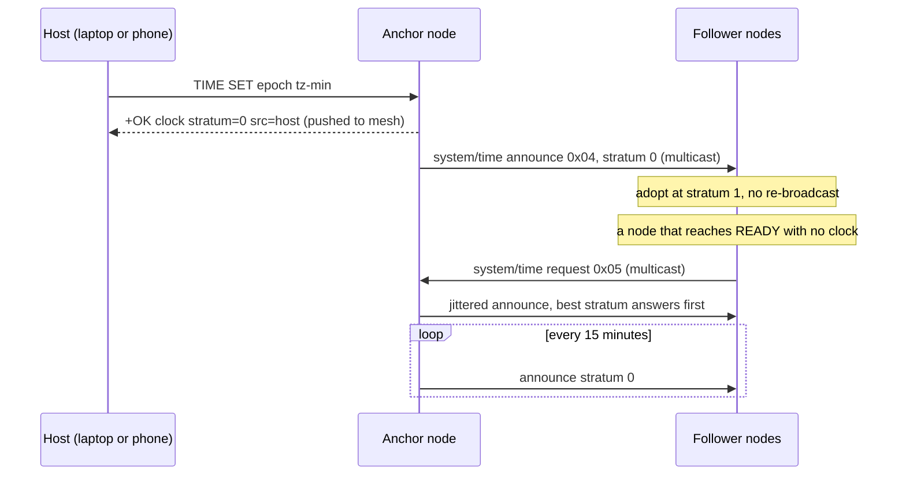

A Hanasu mesh has no border router, so there is no SNTP, and `esp_timer` only ever gives uptime. A shared clock is still worth having for log correlation across nodes, timestamped chat in the app, and anything a bot or script wants to say about "now". The host on the other end of the link has a real clock, so mesh time pushes the host's clock into the mesh. The spec is `docs/MESH-TIME.md`; the code is in `magnet_core.c`.



## The stratum model

One host seeds **one** node over HCP. That node becomes **stratum 0**, the anchor, and multicasts its clock to the channel. Every other node adopts it at **stratum + 1**.



```
$ python tools/hcp.py synctime           # seeds the first node it finds
/dev/cu.usbmodem11201   TIME SET 1785883701 -420
+OK clock=15:48:21 tz=-420 stratum=0 src=host age=0s (pushed to mesh)
```

Each other node then logs, within about a second:

```
# time adopted from 2ca44570 (clock=15:48:21 tz=-420 stratum=1 src=2ca44570 age=0s)
```

### The rules that keep it stable

1. **Receivers never re-broadcast.** Thread's MPL already floods realm-local multicast across the mesh, so forwarding would add no reach and would cause a storm. One announce reaches every node.
2. **A better stratum always wins and a worse one is ignored.** At equal stratum a node accepts a refresh from the source it already follows, and otherwise picks the lower sender id. That tie-break matters: without a fixed rule, two equal peers would keep re-adopting each other's clock, adding announce latency as drift on every round trip.
3. **Stratum 4 and above is refused** (`MN_TIME_MAX_STRATUM`). This bounds how far from a real clock the mesh will spread time.
4. **A request gets one answer.** Every node that has a clock schedules a reply after a delay of `stratum × 400 + 50…400 ms`. Hearing any announce cancels a pending reply. The best clock in range answers first and the others stand down. A node with no clock never replies.
5. **Convergence is automatic.** The anchor re-announces every 15 minutes (`MN_TIME_REFRESH_MS`). A node that reaches READY with no clock sends one request. A node that reaches READY as stratum 0 pushes instead. Nodes that already have a clock stay quiet, so healing a partition does not cause a burst of requests.

## Wire format

Mesh time uses two system commands (Type 1, namespace `0x00`), alongside `0x02` announce-name and `0x03` rotate. The full command table is on the [protocol page](/docs/hanasu/protocol/).

**`0x04` time announce** has 11 parameter bytes:

| Bytes | Field |
|---|---|
| 0–7 | Epoch seconds, int64 big-endian, UTC |
| 8–9 | Time zone offset in minutes east of UTC, int16 big-endian |
| 10 | Stratum **of the sender**. Receivers adopt stratum + 1 |

**`0x05` time request** has no parameters.

A received clock must pass a sanity check before it is applied: the epoch must be at least 1700000000 (November 2023) and the offset must be between −720 and +840 minutes.

## Verbs

| Intent | HCP | Forth |
|---|---|---|
| Show clock, offset, stratum, source, age | `TIME` (or `TIME GET`) | `mn-now` ( -- ) |
| Seed from the host and push to the mesh | `TIME SET <epoch> [<tz-min>]` | `mn-time!` ( epoch -- f ) |
| Re-announce this node's clock | `TIME PUSH` | `mn-time-push` ( -- f ) |
| Ask the mesh for the time | `TIME SYNC` | `mn-time-sync` ( -- f ) |

| Command | Success | Error |
|---|---|---|
| `TIME` | `+OK clock=HH:MM:SS tz=<min> stratum=<n> src=<host or id> age=<s>s` | |
| `TIME SET <epoch> [<tz-min>]` | `+OK … (pushed to mesh)` | `E_SYNTAX` for a missing or implausible epoch or offset |
| `TIME PUSH` | `+OK pushed` | `E_BAD_STATE` if the clock is unset |
| `TIME SYNC` | `+OK requested (adopted async as '# time adopted')` | `E_INTERNAL` if the send fails |

`tz-min` is minutes east of UTC: JST is `540`, PDT is `-420`, UTC is `0`. `python tools/hcp.py synctime [<port>]` computes the epoch and offset on the host and sends `TIME SET`, which is the intended everyday path. The phone app (`magnet_app`) sends `TIME SET` on every successful connect.

`mn-time!` sets UTC only (offset 0). A Forth cell is 32 bits on the C6, so this form works until 2038. `TIME SET` takes a 64-bit value.

Until a clock is set, a node reports `clock=unset` when asked directly, and its time strings fall back to uptime (for example `up 3h07m`). It never invents a date.

## The anchor role

The clock lives in RAM only. When the anchor reboots, the mesh loses its only real time source, and the next node to boot adopts from a follower, one hop worse. Repeated reboots ratchet the mesh upward until stratum 4 stops time distribution entirely. Because receivers never re-broadcast, **any node at stratum 2 or higher means no stratum-0 node answered.** Every such adoption emits:

```
!WARN time-no-anchor stratum=2 — no stratum-0 node on this mesh; re-seed with TIME SET (tools/hcp.py synctime)
```

Since punch-list item H7 (2026-08-14) the node persists the **role, never the clock**:

| Situation | Behavior |
|---|---|
| `TIME SET` on a node | The node becomes the anchor and records it in NVS (`t_anchor`) |
| An ex-anchor reaches READY with no clock | It sends its normal request and emits `!WARN time-anchor-await-seed` |
| An ex-anchor adopts mesh time instead | It emits `!WARN time-anchor-degraded stratum=N` once |
| A **different** node announces at stratum 0 | The persisted role is released: `# time anchor moved to <id>` |

Persisting the clock itself was rejected on purpose: a node that had been off for an unknown time would come back announcing a confidently wrong time at stratum 0, which is worse than no clock.

**Operational rule: re-seed after the anchor reboots.** On the bench, one `TIME SET` took the mesh from strata 2/3/3/2 back to 0/1/1/1 in under 0.1 s. While an anchor is alive, the mesh heals itself, because a stratum-0 announce always beats an equal or worse source.

### Two seeded nodes

Seed one node. If you seed two, both stay at stratum 0 (each ignores the other's announce, because adopting it would mean stratum 1), and followers settle on the one with the **lower device id**. The result is deterministic and does not oscillate, but the two anchors can disagree with each other. `hcp.py synctime` seeds exactly one node for this reason. Long-term behavior with two anchors has been observed briefly but not soaked.

## Accuracy and limits

| Property | As stated in the spec |
|---|---|
| Accuracy | Roughly ±1 second |
| Delay compensation | None. Frame latency is added as-is at each hop, which is why the stratum cap matters |
| Drift | The C6 crystal drifts on the order of a second a day. The 15-minute refresh keeps followers well inside that |
| Date | Not kept. Only the time of day is available, with no date and no DST rules |

**This is not NTP** and should not be used as if it were. It is meant for log stamps and bot lines. If sub-second accuracy is ever needed, the spec suggests measuring the round trip and halving it, or using Thread's network time if a border router is added.

The date limit is deliberate. `settimeofday` plus `strftime` and `tzset` measured about 8.8 KB of flash in newlib's formatting and time zone code. The clock is instead anchored to `esp_timer`, and the time of day comes from three integer divisions.

## Trust model

Time frames are channel-encrypted like everything else, so **anyone who can send chat can set the mesh clock.** That is deliberate: it is the same boundary chat already has, and nothing security-critical depends on the clock. Replay defense uses the monotonic counter, not a timestamp (see [Security](/docs/hanasu/security/)). If that changes, time would become an `ADMIN|SIGNED` frame like system/rotate. Carrying a stratum rather than a bare timestamp leaves room for that.

## Bench results

From the 2026-08-04 run on four nodes:

| Check | Result |
|---|---|
| All four boot with `clock=unset` | Pass |
| Seeded node becomes `stratum=0 src=host` | Pass |
| All three followers adopt, at exactly stratum 1 | Pass |
| Node clocks agree with each other | Pass, 1 s spread |
| Mesh clock matches the host | Pass, −1 s on every node |
| `TIME SYNC` draws exactly one answer | Pass |
| Rebooted follower re-adopts with no host | Pass, 1.3 s after boot |
| 15-minute anchor refresh | Pass, all followers re-adopted together |
| Seeding from the phone app over BLE | Pass, the companion node became `stratum=0 src=host` |

When comparing a node's `clock=` to the host in a test harness, timestamp the arrival of the reply. Reading the host clock after a settle window makes every node look seconds slow, which is harness lag, not mesh error.
