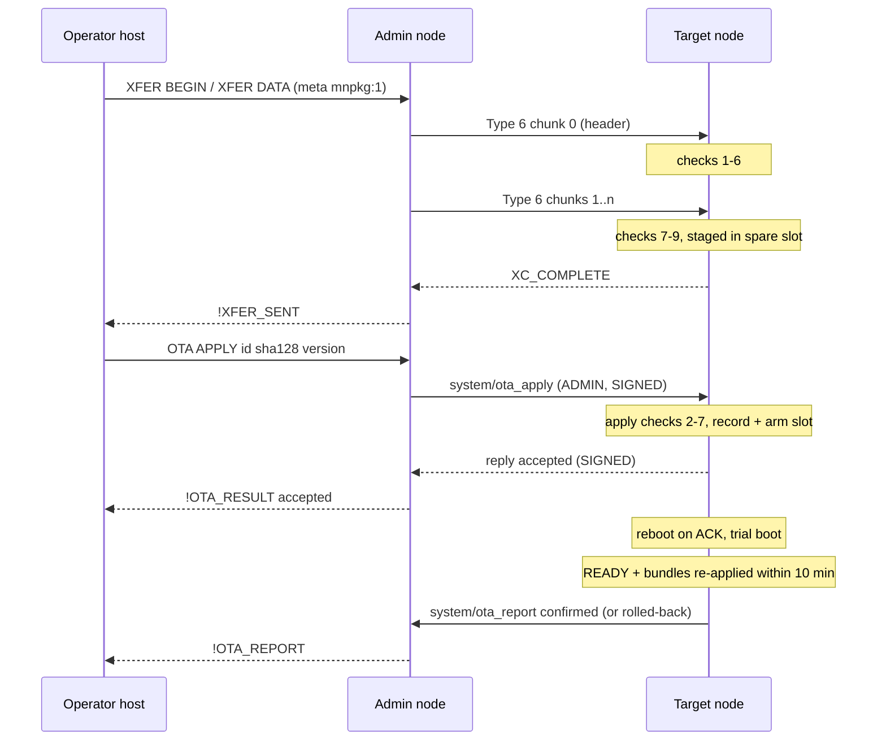

Hanasu nodes update their firmware over the mesh. A release is wrapped in a signed **OTA package** (`.mnpkg`), sent to one node as a [Type 6 extended transfer](/docs/hanasu/extended-transfer/), checked and staged in the node's spare flash slot, and then **applied** by an allow-listed admin with a signed command. The new image boots on trial and confirms itself only once the node is healthy. Otherwise it rolls back without outside help, and the node reports either outcome to the admin who asked.

All of this is implemented on both targets, the XIAO MG24 (Zephyr + MCUboot) and the XIAO ESP32C6 (ESP-IDF), and was validated on hardware in both directions on 2026-09-30. The normative sources are `docs/OTA-PACKAGE.md` (package format, rev 1.4) and `MAGNet_Protocol_DESIGN_PROPOSAL.md` §13 (remote apply, report and revocation, rev 2.4). For the step-by-step procedure, see the [OTA Operator Guide](/docs/hanasu/ota-operations/).

## Three steps, kept apart

| Step | Who can do it | What it changes |
|---|---|---|
| **Stage** | Any node on the channel (a Type 6 transfer) | Nothing that runs. The spare slot holds a verified package, inert until armed |
| **Apply** | An allow-listed admin (`system/ota_apply`, ADMIN\|SIGNED), or a privileged local `ota-apply` | Arms the slot and reboots into it on trial |
| **Confirm or roll back** | The node itself | Keeps the new image if healthy within 10 minutes, otherwise reverts |

Staging is harmless by design. Applying reboots the node and changes what it runs, so that is the privileged step.

## Why a package, not a raw image

The first MG24 implementation shipped a bare MCUboot image and relied on MCUboot's signature check. That does not carry over to the ESP32-C6: a C6 without ESP secure boot (an irreversible eFuse decision the project is not making) boots any well-formed app image. So the node itself must decide, before anything is staged, that an image:

1. was released by a trusted key (**authenticity**),
2. arrived intact (**integrity**),
3. is meant for this chip and board (**targeting**: an MG24 image in a C6 slot, or an image without the XIAO RF-switch bring-up on a XIAO, bricks the radio),
4. is an acceptable version (**version policy**).

A small signed header answers all four the same way on every platform, and the platform's own image format rides inside it unchanged.

## Package layout

A package is a fixed **256-byte header** followed by the platform image, byte for byte. There is no trailer. The header always fits whole in chunk 0 of a Type 6 transfer (336 bytes), and every payload byte lands at package offset − 256, which keeps flash writes 4-byte aligned. File extension `.mnpkg`, MIME `application/vnd.magnet.ota-package`.

All multi-byte integers are big-endian. Reserved bytes must be zero when written and are verified zero when read.

| Offset | Size | Field | Meaning |
|---:|---:|---|---|
| 0 | 4 | `magic` | `MNPK` |
| 4 | 1 | `format_version` | `1` |
| 5 | 1 | `sig_alg` | `2` = Ed25519 (preferred), `1` = deterministic ECDSA P-256 / SHA-256 |
| 6 | 2 | `header_len` | `256` |
| 8 | 2 | `chip` | Chip ID from the registry |
| 10 | 2 | `board` | Board ID; `0` = any board of that chip |
| 12 | 1 | `image_format` | `1` ESP-IDF app image, `2` MCUboot signed image |
| 13 | 1 | `flags` | bit 0 `REQUIRES_REPARTITION`, bit 1 `CLEARS_BUNDLES` |
| 16 | 8 | `version` | major u8, minor u8, revision u16, build u32 |
| 24 | 8 | `min_running` | The node must already run at least this version (all-zero = no floor) |
| 32 | 4 | `image_len` | Payload length |
| 36 | 32 | `image_sha256` | SHA-256 over the payload |
| 68 | 8 | `build_time` | Unix seconds (informational) |
| 76 | 16 | `variant` | Build flavor, e.g. `ble-resident` (informational) |
| 92 | 32 | `fw_version` | The firmware's version string (informational) |
| 124 | 8 | `key_id` | SHA-256(release public key)[0:8] |
| 132 | 60 | reserved | Zero |
| 192 | 64 | `signature` | Over header bytes 0–191 |

The signature covers every header byte before it, including `image_sha256`, so it covers the payload too. Ed25519 signs the 192 raw header bytes; P-256 signs SHA-256 of them (r ‖ s). Everywhere else (the apply command, `!OTA` events, tooling) a staged package is identified by **`sha128`**, the first 16 bytes of `image_sha256`.



### Chip and board registry

`chip` and `board` come from an append-only registry in `docs/OTA-PACKAGE.md` §3.1: a value is never reused or redefined, and a board ID's high byte is its chip ID. It covers six chips (ESP32-C6 `0x0001`, EFR32MG24 `0x0002`, classic ESP32, ESP32-S3, ESP32-C3, nRF52840) and every board in use across the MagNET repos. The two that Hanasu OTA builds use today:

| Board ID | Board | `mnpkg.py --board` |
|---|---|---|
| `0x0102` | Seeed XIAO ESP32C6 | `xiao-esp32c6` |
| `0x0201` | Seeed XIAO MG24 | `xiao-mg24` |

`tools/mnpkg.py` carries the same table and refuses a board that does not belong to the given chip.

## The nine checks

A receiving node runs these in order and stages nothing unless all pass. Checks 1–6 need only the header, so the node runs them the moment chunk 0 arrives and refuses a bad package before its payload crosses the air. Checks 7–9 run after the last chunk.

| # | Check | Code |
|---|---|---|
| 1 | Magic, `format_version == 1`, `header_len == 256`, known `sig_alg`, no unknown flag bits, reserved bytes zero | `E_PKG_FORMAT` |
| 2 | `key_id` names a key in the node's release-key store | `E_PKG_KEY` |
| 3 | Signature verifies with that key, under the key's own algorithm | `E_PKG_SIG` |
| 4 | Chip matches, board matches (or is `0`), image format is the one this chip runs | `E_PKG_TARGET` |
| 5 | `REQUIRES_REPARTITION` is clear | `E_PKG_REPARTITION` |
| 6 | `image_len` equals the transfer length − 256 and fits the update slot | `E_PKG_SIZE` |
| 7 | SHA-256 of the payload **as read back from flash** equals `image_sha256` | `E_PKG_SHA` |
| 8 | The platform's own image check passes | `E_PKG_IMAGE` |
| 9 | Running version ≥ `min_running` | `E_PKG_MIN` |

Check 7 hashes what was read back, not what arrived, so it also catches a bad flash write. The downgrade rule is deliberately **not** a staging check: it is enforced at apply time, so an admin can stage a known-good older build ahead of an emergency rollback.

The node answers the sender with `XC_COMPLETE` only if all nine passed, and `XC_REFUSED` otherwise, with the failing check number in the STATUS frame's reason byte. So on the sender, `!XFER_SENT` means "staged and verified", and a refusal reads `!XFER_FAIL <xid> refused:<n>`.

### Release keys

Each image carries a compiled-in store of up to two release keys, **current** and **next**. Rotating keys means shipping an image, signed by the current key, whose store holds the next one. Nodes must support Ed25519 and should support P-256; both Hanasu targets do. The release key is separate from the admin keys (who may apply), the MCUboot key (what may boot on the MG24) and bundle author keys (what Forth may run). Holding one grants none of the others.

The repo's DEV release keys are public. A build that trusts them says so at boot with `!WARN ota-dev-keys`, and `mnpkg.py build` refuses a DEV key unless the variant name starts with `dev`. Release builds use keys generated offline; see the [operator guide](/docs/hanasu/ota-operations/#key-setup).

## Staging on each platform

The transfer is one Type 6 transfer, CON unicast, with meta `mnpkg:1`. A node with an OTA sink claims a transfer by that meta, keeps the header in RAM, and writes payload bytes to its update slot.

| | XIAO MG24 (Zephyr) | XIAO ESP32C6 (ESP-IDF) |
|---|---|---|
| Update slot | MCUboot `slot1`, 712 KB | The inactive `ota_N` partition, 1792 KB |
| Usable payload | 712 KB − 16 KB (move-mode sector + trailer reserve) | The whole slot |
| Erase | 8 KB pages, erased on first touch; the slot's last page is wiped first so a stale trailer cannot trigger a swap | 4 KB sectors, erased on first touch (`esp_ota_begin` would erase the whole slot up front and cannot take out-of-order chunks) |
| Check 8 | MCUboot header parses and its size fields are consistent | `esp_image_verify()`, the bootloader's own image check |
| Payload format | Unpadded `zephyr.signed.bin`; the slot trailer is written at apply time | The unmodified IDF `firmware.bin` |
| Second signature | MCUboot re-verifies its own ECDSA P-256 signature at boot | None: the package signature is the only authenticity check |

On success the node logs `!OTA staged v<version> <sha128 prefix> … — FORTH: ota-apply`. The Forth word `ota-status` prints the running image and what is staged.

### The C6 partition table

OTA on the C6 needs a dual-slot table, `firmware-idf/partitions_ota.csv`, which fits 4 MB parts:

| Partition | Offset | Size | Note |
|---|---|---|---|
| `nvs` | `0x9000` | 24 KB | Unchanged, so identity, name, channel and BLE bonds survive the move |
| `otadata` | `0xF000` | 8 KB | |
| `phy_init` | `0x11000` | 4 KB | |
| `ota_0` | `0x20000` | 1792 KB | |
| `ota_1` | `0x1E0000` | 1792 KB | |
| `scripts` | `0x3A0000` | 384 KB | LittleFS, reserved and unused today |

The BLE+LED image is about 1.16 MB (65 % of a slot) and the Thread-only image about 852 KB. A partition table cannot change over the air, so moving a node onto this table is a **one-time USB flash** of the OTA env (`esp32c6_xiao_ble_led_ota`, which also enables `CONFIG_BOOTLOADER_APP_ROLLBACK_ENABLE`). A package whose build changes the partition table must set `REQUIRES_REPARTITION`, and nodes refuse such packages over the air.

### The MG24 flash map

The MG24 build uses MCUboot in **swap-using-move** mode with the map in `firmware-zephyr/boards/mg24_partitions.dtsi`: MCUboot 48 KB, `slot0` 712 KB, `slot1` 712 KB, and `storage` 64 KB at `0x170000`, where the pre-MCUboot build put it, so identity and bonds survive. See [XIAO MG24 on Zephyr](/docs/hanasu/mg24-zephyr/#mcuboot-and-the-flash-map).

## Trial, confirm, rollback

Both platforms apply the same health policy, with each platform's own mechanism underneath:

| | XIAO MG24 | XIAO ESP32C6 |
|---|---|---|
| Arm | `boot_request_upgrade(TEST or PERMANENT)` | `esp_ota_set_boot_partition()` (re-verifies the image) |
| Trial state | MCUboot TEST: the next reset swaps the old image back unless confirmed | IDF `PENDING_VERIFY`: the bootloader reverts an image that was booted and never marked valid |
| Confirm | `boot_write_img_confirmed()` | `esp_ota_mark_app_valid_cancel_rollback()` |
| Power loss mid-swap | Swap-using-move is power-fail safe | Not applicable (no swap) |

A new image is **healthy**, and only then confirmed, when both hold:

1. the node reached READY (Thread attached), and
2. every persisted Forth role bundle re-applied without error at boot (or none was persisted).

The node polls every 2 seconds. If it is not healthy within **10 minutes** it logs `!WARN ota-unhealthy` and reboots, and the bootloader reverts. The bundle half of the rule matters: a firmware update can remove an FFI word a saved bundle uses. The bundle then fails to re-apply (safely), but the node still reaches READY, so a READY-only rule would confirm an image that had silently lost the node's role.

**PERMANENT** mode skips the trial. On the MG24 it is MCUboot's permanent upgrade; on the C6 the new image marks itself valid at its first boot when the apply record says PERMANENT. TEST is the default; PERMANENT is used only when explicitly requested.

## Admin-signed remote apply

`system/ota_apply` (namespace `0x00`, command `0x06`) is a Type 1 M2M command on the existing admin plane: ENCRYPTED, SIGNED and ADMIN, signed by the sender's identity key and verified against the receiver's admin allow-list before dispatch. It is sent CON unicast to the target, never multicast.

| Param | Bytes | Meaning |
|---|---:|---|
| `target_id` | 4 | The device ID the command is for |
| `sha128` | 16 | `image_sha256[0:16]` of the staged package |
| `version` | 8 | The staged package's version |
| `mode` | 1 | `0` TEST, `1` PERMANENT |
| `flags` | 1 | bit 0 `ALLOW_DOWNGRADE`; other bits must be 0 |

The receiver checks, in this order; any failure answers with the code and changes nothing. The status byte is the check number.

| # | Check | Status |
|---|---|---|
| 1 | Frame is ADMIN\|SIGNED by an allow-listed key | Silently dropped |
| 2 | `target_id` is this node | `E_NOT_TARGET` (2) |
| 7 | This build supports OTA, `mode` ≤ 1, no unknown flag bit | `E_UNSUPPORTED` (7) |
| 3 | A package is staged and not still being received | `E_NOT_STAGED` (3) |
| 4 | Staged `sha128` matches | `E_SHA_MISMATCH` (4) |
| 5 | Staged package header version matches `version` | `E_VERSION_MISMATCH` (5) |
| 6 | `version` > running, unless `ALLOW_DOWNGRADE` | `E_DOWNGRADE` (6) |

Check 7 runs right after check 2, so a build without OTA answers 7 rather than 3. A build without an OTA sink links weak defaults that answer `E_UNSUPPORTED`.

On success the node records the apply in NVS (the admin's device ID and address, the new and previous versions, the mode), notes the `CLEARS_BUNDLES` flag, arms the slot, and replies `accepted`. It reboots **once the reply's CoAP ACK arrives** (+0.5 s), or at a 20-second cap if it never does. Earlier drafts used a fixed short delay, which lost the reply on the bench whenever the first transmissions were lost; the cap keeps a lost admin from stranding an armed node.

The reply is a Type 2 M2M Response, 74 bytes: status, the target's running version, and its 65-byte identity public key. It is SIGNED (not ADMIN) with the target's own key. The admin does not hold that key in advance, so it checks the signature and that `SHA-256(pubkey)[0:4]` equals the sender's device ID. SIGNED-without-ADMIN frames are accepted only for this reply and the report; any other is dropped.

## The post-reboot report

The result of an apply is only visible after the reboot, so the target reports once its OTA state settles. `system/ota_report` (namespace `0x00`, command `0x07`) carries 83 bytes:

| Field | Bytes | Meaning |
|---|---:|---|
| `outcome` | 1 | `1` CONFIRMED (new image healthy), `2` ROLLED_BACK |
| running version | 8 | What the node runs now |
| other version | 8 | CONFIRMED: the version it replaced. ROLLED_BACK: the version that failed |
| `bundles` | 1 | `0` none persisted, `1` all re-applied, `2` a re-apply failed, `3` cleared (`CLEARS_BUNDLES`) |
| public key | 65 | The target's identity key, checked as for the reply |

The outcome is decided by version, not by platform state: running equals the applied version → CONFIRMED; running equals the version before the apply → ROLLED_BACK; anything else (reflashed by hand since) → the record is dropped silently. A rollback is reported by the **old** image on the boot after the revert. The report waits for READY and goes CON unicast to the admin that issued the apply, falling back to channel multicast if that send fails. A local `ota-apply` leaves no apply record, so it produces no report.

On the admin's host link the exchange reads:

```
OTA APPLY <peer-id|ipv6> <sha128-hex> <maj.min.rev+build> [PERM] [DOWNGRADE]
+OK sent
!OTA_RESULT <id> accepted v<running>
!OTA_REPORT <id> confirmed v<new> (was v<old>) bundles=<n>
!OTA_REPORT <id> rolled-back v<old> (failed v<new>) bundles=<n>
```



## CLEARS_BUNDLES

Flag bit 1 is for firmware that breaks the Forth vocabulary on purpose. While such an image is on trial the node does **not** re-apply its saved bundles: health reduces to READY and the report says `bundles=3`. Once the image is confirmed, the node **forgets** the saved bundles, and the operator redeploys bundles written for the new vocabulary. If the image rolls back instead, the bundles were never touched and the old image re-applies them as usual.

Nodes record the flag whenever an image is armed, by local `ota-apply` or remote apply, keyed by the image's version. Package format revisions 1.0–1.3 said "forget on first boot", which lost the bundles on a rollback; rev 1.4 holds them back during the trial instead.

## Admin keys and revocation

Admin keys are named by **fingerprint**, `SHA-256(65-byte pubkey)[0:8]`, which `ADMIN LIST` prints. Its first 4 bytes are the key owner's device ID. A node allow-lists up to 4 admin keys.

| Command | Scope |
|---|---|
| `ADMIN REMOVE <n \| fp>` | This node's allow-list only |
| `ADMIN REVOKE <fp>` | Sends a signed `system/admin_revoke` to the whole channel, then removes the key locally |

`system/admin_revoke` (namespace `0x00`, command `0x08`) carries the 8-byte fingerprint, is ADMIN\|SIGNED, and is verified against the receiver's allow-list like any admin command. Unlike apply it is **multicast NON**: revocation must reach every node, and it is idempotent, so the operator repeats it to cover a lost frame. An admin may revoke its own key, because the frame is signed before the local removal. A node that does not hold the key logs `# admin revoke: key not held`.

Limits: revocation cannot stop a thief who still holds a valid admin key from revoking the others just as fast, and a node that was offline when the revoke went out keeps the key until it is revoked again. There is no revocation list.

## Threats

| Threat | Mitigation |
|---|---|
| A channel member triggers apply | Needs an allow-listed admin signature |
| Replay of a captured apply | Counter high-water, and the command is bound to `target_id` plus the `sha128` of what is staged **now**; a replay against a different or already-applied image fails check 3 or 4 |
| An evicted sender replays once | Same binding; at worst it re-applies the identical image |
| A rogue member overwrites the slot after staging | Apply fails `E_SHA_MISMATCH`; the admin restages (denial of service, not compromise) |
| Malicious image | Release-key signature checked before staging on every platform (the C6's only check); MCUboot re-checks its own signature on the MG24 |
| Downgrade to an old signed image with a known bug | Check 6; `ALLOW_DOWNGRADE` is an explicit, signed admin choice |
| Bricked radio after an update | TEST mode, confirm-when-healthy, 10-minute deadline, automatic rollback |
| Power loss mid-transfer or mid-swap | Transfer: nothing staged, restage. Swap: swap-using-move is power-fail safe |
| Stolen admin key | `ADMIN REMOVE` locally, signed `ADMIN REVOKE` on the mesh; recovery is `ADMIN ADD` over a bonded link or serial |
| Forged apply reply or report | Signature plus `SHA-256(pubkey)[0:4] == device_id`. That binding is only 32 bits: a member willing to grind about 2³² P-256 keys could impersonate one node's report (not its apply). Planned: replace with the full key once peers exchange keys |

Fleet rollout is sequential with a canary: one node first, the next only after its CONFIRMED report, never a multicast apply.

## Hardware validation

Run 2026-09-30 between a XIAO MG24 (Zephyr, BLE-resident, MCUboot) and a XIAO ESP32C6 (`esp32c6_xiao_ble_led_ota`), each allow-listing the other's key. Every row was observed on hardware:

| Case | Observed |
|---|---|
| Apply signed by a key the target does not allow-list | No reply, nothing logged, image untouched |
| Nothing staged / wrong SHA / wrong version | `E_NOT_STAGED` / `E_SHA_MISMATCH` / `E_VERSION_MISMATCH`, no reboot |
| Older version staged | `E_DOWNGRADE`; with `DOWNGRADE`, accepted and confirmed |
| Happy path, C6 admin → MG24 | accepted → swap → TEST → confirmed, report received on the C6 |
| Forced-unhealthy MG24 image | Not healthy in 20 s (test build) → MCUboot revert → `rolled-back` report |
| Same apply resent after success | `E_NOT_STAGED` |
| Captured apply frame replayed byte for byte | Immediately: dropped by the counter high-water. After the target rebooted (high-water table empty): reached dispatch and got `E_NOT_STAGED`, so the staged-image binding is what stops it |
| `CLEARS_BUNDLES`, image rolls back | Bundles held back on trial, re-applied by the old image, report `bundles=1`, bundle still listed |
| `CLEARS_BUNDLES`, image confirms | Held back, confirmed, bundle forgotten, report `bundles=3` |
| BLE host path: Mac → bonded BLE → MG24 `OTA APPLY` → C6 | `!OTA_RESULT` and `!OTA_REPORT` both arrived as BLE notifications |
| Package rejection matrix (wrong key, bad signature, wrong chip or board, truncated or flipped payload) | Covered by the staging runs plus the host test suite `tools/pkgtest`, 25/25 |
| MG24 admin → C6 target | accepted → `ota_1` TEST → confirmed, with the C6's saved role bundle re-applied |
| Forced-unhealthy C6 image | Reverted by IDF app rollback |
| `ADMIN REVOKE` (MG24 revokes its own key on the C6) | C6 logs `!WARN admin-revoked`; the next apply from the MG24 was silently dropped |

Two Zephyr-port bugs surfaced during these runs. The `accepted` reply was lost on several MG24 applies because the compat layer allocated FreeRTOS timer control blocks from the kernel heap, which BLE exhausts at runtime, so the reboot timer could not be created. The NVS shim had the same root cause: its key-list snapshot came from the kernel heap, so at runtime every NVS enumeration silently returned nothing. Both now allocate from the libc arena. Not covered by this run: refusal of a privileged verb on an unbonded BLE link (that gate was validated earlier, in the BLE phase).

Staging speed is bound by the node and radio round trip: `tools/ota_push.py` moves about 90 ms per 336-byte chunk. C6 → MG24 with a 557 KB package took 137–169 s; MG24 → C6 with 1.17 MB took 385 s.
